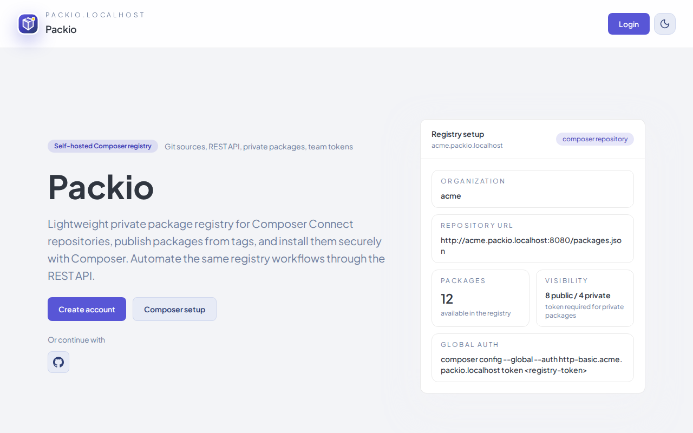

# Packio

Packio is a self-hosted private Composer package registry. It provides organization and package management, release publishing, private registry tokens, a REST API, and GitHub, GitLab, Bitbucket, and Codeberg source integrations.



To try Packio without installing it, register at [packio.us](https://packio.us), a live instance run by the maintainer. Registration is open.

## Supported deployment

Packio supports a Linux single host on amd64, using RoadRunner 2025.1.15, PHP 8.5.x, Node 24.21.0 for the image build, and PostgreSQL 17. The published images run the application, queue and maintenance workers, optional Inertia SSR, and PostgreSQL. See [the support scope](docs/support.md) for the full list of supported, experimental and unsupported configurations.

## Try it locally

Try Packio on your own machine from the published images. No clone, no build, no GitHub token. It serves plain HTTP and is not a production setup.

Requirements: Linux on amd64, Docker with Compose v2, curl. Find the latest version on the [releases page](https://github.com/packio-php/packio/releases) and replace `X.Y.Z` with it (without the `v`):

```bash
mkdir packio && cd packio
curl -fsSL https://github.com/packio-php/packio/archive/refs/tags/vX.Y.Z.tar.gz | tar -xz --strip-components=2 --wildcards '*/deploy/*'
cp .env.local.example .env
docker compose up -d
```

Open `http://packio.localhost:8080` and register. The verification code arrives in Mailpit at `http://localhost:8025`. Then create an organization, open Tokens, issue a token and follow the Registry Setup page to use it with Composer. Remove everything, including the data:

```bash
docker compose down -v
```

To try Packio with your own GitHub repositories, or to work on the code, see [the source-based trial](docs/docker.md#try-the-development-stack-from-source).

## Install on a server

1. Download `deploy/` and copy `.env.example` to `.env`.
2. Fill in the domain, two secrets and the mail address, and choose the Caddy line for automatic HTTPS.
3. Run `docker compose up -d`.

The full guide with every command: [Self-hosting Packio](docs/self-hosting.md). Building from a Git clone is described in [Docker and runtime operations](docs/docker.md#install-from-a-clean-git-clone).

## First account and Composer setup

Register through the app, then verify the account using the email sent through your configured SMTP service. After registration, promote the existing user to admin from the app container:

```bash
docker compose exec app php vendor/bin/laminas user:make-admin admin@example.com
```

This is the command for the `deploy/` setup. With a source build, add `--env-file .env.prod.local -f compose.prod.yaml` after `docker compose`.

Sign in as that user and create an organization. To import repositories, configure a source OAuth app for the provider, connect that account, add a repository, and run a source sync from its page. Login OAuth is optional; source OAuth setup is covered in [the OAuth guide](docs/oauth.md).

Create a registry token for the organization in **Organization → Tokens**. In **Organization → Registry**, Packio shows the Composer repository URL and auth host for that organization. Configure authentication globally so the token is written to Composer's global `auth.json`, outside the consuming project:

```bash
composer config --global --auth http-basic.acme.packio.example.com token '<registry-token>'
```

If you prefer project-local credentials, add `/auth.json` to the **consuming project's** `.gitignore` before writing the token. Then run this command in that project instead of the global command:

```bash
composer config --auth http-basic.acme.packio.example.com token '<registry-token>'
```

Add the private repository URL shown in Packio to the consuming project's `composer.json`:

```json
{
  "repositories": [
    { "type": "composer", "url": "https://acme.packio.example.com/private/" }
  ]
}
```

Replace `acme` with your organization slug and `packio.example.com` with your registry domain. The hostname in Composer's `http-basic` configuration must exactly match the organization registry hostname in the repository URL. Keep the token out of `composer.json`, `composer.lock`, and source control; use Composer's auth file or an injected `COMPOSER_AUTH` secret in CI.

Then install a private package with Composer:

```bash
composer require 'acme/private-library:^1.0'
```

Replace the package name and version with one published by your organization.

## Development and reference

For local development, use [the development Compose guide](docs/docker.md#local-command-matrix). The host tooling targets PHP 8.5.x and Node 24.21.0. Copy `.env.example` to `.env`; local defaults use PostgreSQL on `localhost:15432` and Packio's localhost development domains.

- [Environment variables](ENV.md)
- [Self-hosting guide](docs/self-hosting.md)
- [Docker and runtime operations](docs/docker.md)
- [Support matrix](docs/support.md)
- [Testing](docs/testing.md)
- [Application CLI commands](docs/commands.md)
- [OAuth setup](docs/oauth.md)
- [Authentication and authorization](docs/authentication-authorization.md)
- [REST API contract](docs/api-rest-contract.md)
- [Module architecture](docs/development/architecture.md)
- [Adapter boundaries, including webhooks](docs/development/adapter-boundaries.md)
- [Runtime settings](docs/runtime-settings.md)
- [Rate limiting](docs/rate-limiting.md)
- [Object mapper](docs/object-mapper.md)
- [PHP dependency security](docs/security/php-dependencies.md)

## License

MIT
