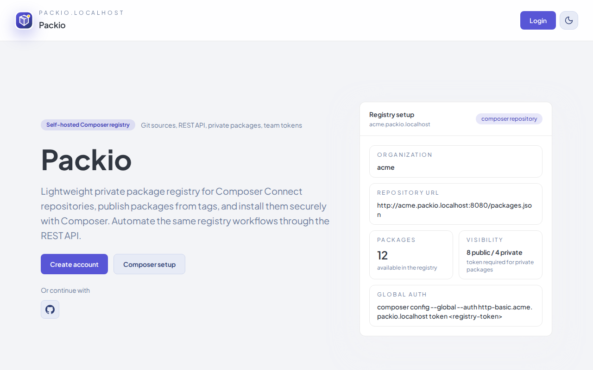

# Packio

Packio is a self-hosted private Composer package registry. It provides organization and package management, release publishing, private registry tokens, a REST API, and GitHub, GitLab, Bitbucket, and Codeberg source integrations.



To try Packio without installing it, register at [packio.us](https://packio.us), a live instance run by the maintainer. Registration is open.

## Supported deployment

Packio supports a Linux single host on amd64, using RoadRunner 2025.1.15, PHP 8.5.x, Node 24.21.0 for the image build, and PostgreSQL 17. The standalone production Compose stack includes the application, queue and maintenance workers, Inertia SSR, and PostgreSQL. See [the support scope](docs/support.md) for the full list of supported, experimental and unsupported configurations.

## Try it locally

Try Packio on your own machine with the development stack. It serves plain HTTP on `localhost` and is not a production setup.

1. Requirements: Linux on amd64 (macOS is not guaranteed), Git, curl, and Docker with Compose. Nothing else is installed on the host. Create a GitHub [classic personal access token](https://github.com/settings/tokens/new?scopes=public_repo,read:org&description=Packio%20trial) before you start, with the scopes `public_repo` and `read:org` (Packio lists your organizations, and GitHub refuses that without `read:org`) and a short expiry.
2. Clone the repository and start the stack:

   ```bash
   git clone https://github.com/packio-php/packio.git
   cd packio
   cp .env.example .env
   ```

   If your user ID (`id -u`) is not 1000, set `PACKIO_DOCKER_UID` and `PACKIO_DOCKER_GID` in `.env` now. Then start the stack and wait until the app answers:

   ```bash
   docker compose -f compose.yaml up -d --build
   until curl -fsS http://localhost:8080/health; do sleep 2; done
   ```

   One `up` command also installs PHP and Node dependencies and builds the SSR bundle. The first start takes 2-3 minutes; later starts take a few seconds. The workers can restart for up to a minute while `app` runs migrations; they recover on their own.
3. Open `http://packio.localhost:8080` and register. The verification code arrives in Mailpit at `http://localhost:8025`.
4. Create an organization, for example `acme`.
5. Open Sources, click Add source, and choose GitHub. Under "or enter token manually", paste your classic GitHub token and click Save provider access, then Continue to add source. The list shows only repositories of the token owner, so pick one of your own public repositories that has a `composer.json` and version tags; if you have none, fork a small Composer package and untick "Copy the main branch only" in GitHub's fork dialog so the fork keeps its tags. Click Connect. If the token cannot create webhooks, Packio only shows a warning; synchronization still works. The source synchronizes in the background; its page shows the sync status and the packages found.
6. Open Tokens (`/organization/acme/tokens`), enter a name, and click Issue token. Copy the token.
7. The Registry Setup page (`/organization/acme/registry/setup`) shows the registry host and repository URL; for `acme` the host is `acme.packio.localhost:8080`. In an empty project folder, run Composer in Docker (Linux; `--network host` lets the container reach the host's port 8080). Any local Composer 2 works too.

   ```bash
   mkdir demo && cd demo
   composer() { docker run --rm -it --user "$(id -u):$(id -g)" --network host -v "$PWD":/app -w /app composer:2.8 "$@"; }
   composer init --no-interaction --name acme/demo
   composer config secure-http false   # only for this local trial: the registry is plain HTTP
   composer config --auth http-basic.acme.packio.localhost:8080 token '<registry-token>'
   composer config repositories.packio composer '<repository URL from the Registry page>'
   composer require <vendor/package>
   ```
8. Stop and remove everything, including the database volume:

   ```bash
   docker compose -f compose.yaml down -v
   ```

## Install from a clean Git clone

The production build requires Git metadata. Do not use a source archive as a substitute for a Git checkout.

```bash
git clone https://github.com/packio-php/packio.git packio
cd packio
cp .env.prod.example .env.prod.local
chmod 600 .env.prod.local
openssl rand -hex 32     # set DATABASE_PASS in .env.prod.local
openssl rand -base64 32  # set APP_SECRET_ENCRYPTION_KEY=base64:<value>
```

Edit `.env.prod.local` before starting the stack:

- Set a unique PostgreSQL password and a persistent encryption key. Keep the key backed up with the database and unchanged across deployments.
- Replace `packio.example.com` with the public application domain in `APP_URL`, `BRAND_DOMAIN`, `BRAND_REGISTRY_BASE_DOMAIN`, and `CORS_ALLOWED_ORIGINS`. Set the matching `PACKIO_APP_DOMAIN` and `PACKIO_REGISTRY_DOMAIN` values for the host Caddy example.
- Point DNS for the application host and `*.<registry-domain>` to the Linux host. Provide a TLS certificate and key covering both the app host and wildcard registry hosts; the Caddy example does not provision certificates.
- Configure a working SMTP `MAIL_DSN`, `MAIL_FROM_ADDRESS`, and optional display name. Authentication emails require SMTP and running queue workers.
- Set `TRUSTED_PROXIES` to the exact proxy peer address observed by the app. Leave it empty if no trusted proxy headers are used; never set it to `*`.

The `.env.prod.local` file contains secrets and must stay private. Do not commit it.

Validate and start all production services:

```bash
docker compose --env-file .env.prod.local -f compose.prod.yaml config --quiet
docker compose --env-file .env.prod.local -f compose.prod.yaml up -d --build --remove-orphans --wait --wait-timeout 300
curl -fsS http://127.0.0.1:8080/health
docker compose --env-file .env.prod.local -f compose.prod.yaml ps
```

Use `compose.prod.yaml` by itself. Its app entrypoint runs pending PostgreSQL migrations and the runtime-settings seed with `RUN_MIGRATIONS=true`; do not run migrations or seed commands manually alongside startup. Workers start after the app is healthy. They are required for queued authentication mail and source/package synchronization. See [Docker operations](docs/docker.md) for the proxy configuration, upgrades, backups, and service details.

## First account and Composer setup

Register through the app, then verify the account using the email sent through your configured SMTP service. After registration, promote the existing user to admin from the app container:

```bash
docker compose --env-file .env.prod.local -f compose.prod.yaml exec app php vendor/bin/laminas user:make-admin admin@example.com
```

Sign in as that user and create an organization. To import repositories, configure a source OAuth app for the provider, connect that account, add a repository, and run a source sync from its page. Login OAuth is optional; source OAuth setup is covered in [the OAuth guide](docs/oauth.md).

Create a registry token for the organization in **Organization → Tokens**. In **Organization → Registry**, Packio shows the Composer repository URL and auth host for that organization. Configure authentication globally so the token is written to Composer's global `auth.json`, outside the consuming project:

```bash
composer config --global --auth http-basic.acme.packio.example.com token '<registry-token>'
```

If you prefer project-local credentials, add `/auth.json` to the **consuming project's** `.gitignore` before writing the token. Then run this command in that project instead of the global command:

```bash
composer config --auth http-basic.acme.packio.example.com token '<registry-token>'
```

Add the private repository URL shown in Packio to the consuming project's `composer.json`:

```json
{
  "repositories": [
    { "type": "composer", "url": "https://acme.packio.example.com/private/" }
  ]
}
```

Replace `acme` with your organization slug and `packio.example.com` with your registry domain. The hostname in Composer's `http-basic` configuration must exactly match the organization registry hostname in the repository URL. Keep the token out of `composer.json`, `composer.lock`, and source control; use Composer's auth file or an injected `COMPOSER_AUTH` secret in CI.

Then install a private package with Composer:

```bash
composer require 'acme/private-library:^1.0'
```

Replace the package name and version with one published by your organization.

## Development and reference

For local development, use [the development Compose guide](docs/docker.md#local-command-matrix). The host tooling targets PHP 8.5.x and Node 24.21.0. Copy `.env.example` to `.env`; local defaults use PostgreSQL on `localhost:15432` and Packio's localhost development domains.

- [Environment variables](ENV.md)
- [Docker and runtime operations](docs/docker.md)
- [Support matrix](docs/support.md)
- [Testing](docs/testing.md)
- [Application CLI commands](docs/commands.md)
- [OAuth setup](docs/oauth.md)
- [Authentication and authorization](docs/authentication-authorization.md)
- [REST API contract](docs/api-rest-contract.md)
- [Module architecture](docs/development/architecture.md)
- [Adapter boundaries, including webhooks](docs/development/adapter-boundaries.md)
- [Runtime settings](docs/runtime-settings.md)
- [Rate limiting](docs/rate-limiting.md)
- [Object mapper](docs/object-mapper.md)
- [PHP dependency security](docs/security/php-dependencies.md)

## License

MIT
